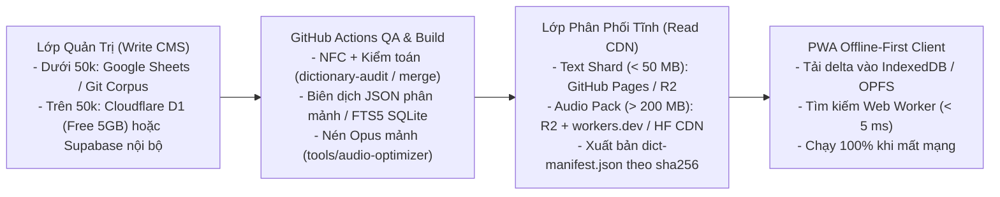

# Kế Hoạch Nâng Cấp Kiến Trúc Dài Hạn (`tudien-xedang`)

- **Mục tiêu:** Đưa ứng dụng Từ điển Xơ Đăng PWA mở rộng mượt mà từ mốc hiện tại (`~1.26k` mục) → **`25k` mục** (`10k` từ đơn + `15k` cụm từ) → **`100k–300k+` mục**, trong khi vẫn giữ **chi phí vận hành `$0`**, **domain miễn phí GitHub Pages (`https://umnuar.github.io/xodang/`)**, **tốc độ tìm kiếm `< 5–10 ms`**, và **hoạt động Offline 100%**.
- **Tham chiếu hiện hành:** [ui-audit-remediation-plan.md](./ui-audit-remediation-plan.md), [vite.config.ts](../vite.config.ts), [generate-snapshot.ts](../scripts/generate-snapshot.ts), [dictionary.service.ts](../src/services/dictionary.service.ts), [dictionary-store.service.ts](../src/services/dictionary-store.service.ts), [search.worker.ts](../src/services/search.worker.ts), [search-client.service.ts](../src/services/search-client.service.ts), [sheets.service.ts](../src/services/sheets.service.ts), [offline-sync.service.ts](../src/services/offline-sync.service.ts), [deploy.yml](../.github/workflows/deploy.yml).
- **Trạng thái:** **Đã triển khai xong Giai đoạn 1 (`25k` scale foundation)** trên nhánh `feat/arch-phase1-25k-scale`; Giai đoạn 2–4 đang chờ mốc ngữ liệu tiếp theo.

---

## 1. Hạ tầng Domain Free GitHub + Cloudflare R2 & Phương án 0 Thẻ

### Trả lời dứt khoát về Cloudflare R2 và Domain
- **KHÔNG cần mua domain riêng:** Web chính vẫn giữ nguyên URL miễn phí GitHub Pages (`https://umnuar.github.io/xodang/`).
- **Không dùng `*.r2.dev` cho production:** Subdomain `*.r2.dev` gắn sẵn của Cloudflare chỉ dành cho dev/test và bị Cloudflare siết rate-limit gắt (`HTTP 429` khi nhiều người tải).
- **Cách chạy `0đ` đúng chuẩn production không cần domain:** Gắn một **Cloudflare Worker (`https://<tên-app>.workers.dev`)** bind trực tiếp vào R2 bucket (`100,000` requests/ngày miễn phí), tự gắn header CORS cho `https://umnuar.github.io`, `Cache-Control: public, max-age=31536000, immutable`, và hỗ trợ HTTP `Range` cho thẻ `<audio>`.

### Lưu ý thanh toán & Kiến trúc chống khóa nhà cung cấp (`Host-Agnostic CDN`)
- **Yêu cầu thẻ ở R2:** Dù Cloudflare R2 Free cho `10 GB` lưu trữ, `10 triệu` lượt đọc/tháng và **`$0` phí băng thông tải ra (Egress)**, Cloudflare **vẫn bắt buộc gắn thẻ Visa/Mastercard hoặc PayPal** để mở tính năng R2 (không thu phí khi dùng dưới hạn mức Free).
- **Phương án cấu hình 2 biến môi trường (`VITE_DATA_BASE_URL`, `VITE_AUDIO_BASE_URL`):** Toàn bộ mã nguồn PWA chỉ đọc gói dữ liệu/audio qua base URL cấu hình, cho phép chuyển đổi giữa 3 hạ tầng miễn phí mà **không phải sửa logic ứng dụng**:

| Phương án CDN | Chi phí | Domain riêng | Cần thẻ/PayPal? | Trần thực tế phù hợp | Ghi chú CSP (`vite.config.ts`) |
| :--- | :---: | :---: | :---: | :--- | :--- |
| **1. GitHub Pages (`./data/`, `./audio/`)** | `$0` | Không | Không | `< 25k` mục + `< 200 MB` audio | `'self'` sẵn có, `0` cấu hình thêm |
| **2. Cloudflare R2 + `*.workers.dev`** | `$0` | Không | **Có** (Visa/PayPal) | `200 MB` → **`10 GB`** (`$0` egress) | Thêm origin `*.workers.dev` vào `connect-src` & `media-src` |
| **3. Hugging Face Dataset CDN** | `$0` | Không | Không | Repo/dataset lớn, tệp tĩnh/audio | `huggingface.co` / `cdn-lfs*.hf.co` **đã có sẵn** trong [vite.config.ts](../vite.config.ts) |

---

## 2. Kiến trúc Đích Dài Hạn (Tách biệt Write CMS ≠ Build Pipeline ≠ Read CDN ≠ Offline Client)

Nguyên tắc sống còn của từ điển cộng đồng: **99.9% lưu lượng là đọc + nghe phát âm offline**. Không bao giờ cho thiết bị người dùng query trực tiếp database quản trị (`Google Sheets` hay `Supabase` miễn phí vốn dễ đụng trần timeout/egress/tự ngủ đông 7 ngày).

---

## 3. Lộ trình Nâng cấp 4 Giai đoạn (Tiến hóa từng bước)

### Giai đoạn 1 — Mở khóa mốc `25k` mục (`10k` từ đơn + `15k` cụm từ · Làm ngay khi tăng ngữ liệu)
Giải quyết triệt để 4 nút thắt hiện tại (`localStorage` `5 MB`, inline snapshot vào `main.js`, Sheets timeout `8s`/`429`, tìm kiếm tuần tự trên main thread):
1. **Xuất gói dữ liệu tĩnh tách khỏi JS bundle:**
   - Nâng cấp [generate-snapshot.ts](../scripts/generate-snapshot.ts) xuất ra `public/data/`:
     - `public/data/dict-manifest.json` (`version`, `schemaVersion`, `chunks[]` gồm `kind: 'word' | 'phrase' | 'quiz' | 'chat'`, `url`, `sha256`, `count`, `bytes`).
     - `public/data/words.json`, `public/data/phrases.json`, `public/data/quiz.json`, `public/data/chat.json` ở dạng **tuple mảng nén khóa**: `[viet, ethnic, pronunciation, driveId, exampleViet, exampleEthnic, kind]` (giảm ~`45%` dung lượng JSON thô; qua gzip của GitHub Pages chỉ còn `~1.1–1.5 MB`).
   - Điều chỉnh [vite.config.ts](../vite.config.ts): **không** inline `25k` dòng vào `main.js`; giữ `main.js < 150 kB` và chỉ nhúng mẫu nhỏ từ [snapshot-fallback.ts](../src/shared/data/snapshot-fallback.ts) để cứu hộ khẩn cấp trước khi tải gói lần đầu.
2. **Thay cache `localStorage` bằng IndexedDB (`dictionary-store.service.ts`):**
   - Tạo `src/services/dictionary-store.service.ts` (DB `tudien-xedang-corpus`, object stores `meta` & `entries`) thay thế `writePersistentCache` dùng `localStorage` tại [sheets.service.ts](../src/services/sheets.service.ts).
   - Khởi động app đọc ngay tập đã lưu trong IndexedDB (`< 30 ms`), chạy nền đối chiếu `dict-manifest.json` và **chỉ tải lại những chunk có `sha256` thay đổi**. Bỏ gọi trực tiếp Google Sheets API từ client (`0` lộ API key, `0` lỗi `429`).
3. **Web Worker tìm kiếm & Inverted Token Index (`search.worker.ts`):**
   - Tạo `src/services/search.worker.ts` theo mẫu ES module worker sẵn có của [whisper-stt.worker.ts](../src/services/whisper-stt.worker.ts).
   - Chuyển [dictionary.service.ts](../src/services/dictionary.service.ts) sang dùng Worker dựng 2 chỉ mục trong bộ nhớ:
     - `exactMap`: tra khớp chính xác `O(1)`.
     - `tokenIndex`: `Map<foldedToken, Uint32Array>` đánh chỉ mục từng tiếng đã bỏ dấu để lọc ứng viên trước khi khớp ranh giới Unicode (`p95 < 5 ms` trên `25k` mục, không đơ giao diện gõ phím).
   - Xếp hạng ưu tiên **từ đơn (`word`) trước cụm từ (`phrase`)**, hỗ trợ phân trang danh sách kết quả (`"Xem thêm"`) để không dựng quá nhiều card DOM cùng lúc.
4. **Lọc ngữ liệu Game theo `kind` & độ dài:**
   - Cập nhật [game-data.ts](../src/features/games/game-data.ts) ưu tiên lấy `kind === 'word'` ở Level đầu và chỉ dùng cụm từ ngắn ở Level cao để không làm quá tải ô thẻ / Canvas Game 2 & 3.

### Giai đoạn 2 — Tách Audio & Asset Nặng khỏi Git Repo (Khi kho audio vượt `~150–200 MB`)
1. **Chia mảnh `audio-pack.bin` theo chủ đề / tần suất:**
   - Nâng cấp [Cargo.toml](../tools/audio-optimizer/Cargo.toml) (`tools/audio-optimizer`) xuất nhiều mảnh `<= 30–50 MB` (`core-top-2000.bin`, `words-part-1..N.bin`, `phrases-part-1..N.bin`) kèm `audio-manifest.json` (có `sha256` và danh sách `driveId` từng mảnh).
   - Cho phép người học tải **Gói phát âm Cốt lõi** trước (~`30 MB`) rồi tải thêm gói cụm từ khi cần.
2. **Đẩy tệp audio lên Cloudflare R2 + `*.workers.dev` (hoặc Hugging Face CDN):**
   - Kết nối `VITE_DATA_BASE_URL` & `VITE_AUDIO_BASE_URL` trong [offline-sync.service.ts](../src/services/offline-sync.service.ts) và cấu hình build-time CSP `connect-src` / `media-src` trong [vite.config.ts](../vite.config.ts).
   - Giữ Git repo gọn nhẹ (`< 50 MB`), tránh phình lịch sử Git và né trần dung lượng build GitHub Pages.

### Giai đoạn 3 — Nâng cấp CMS Quản Trị & Đóng Góp Có Xác Thực (`25k–100k` mục)
1. **Tự động hóa QA ngữ liệu trong GitHub Actions ([deploy.yml](../.github/workflows/deploy.yml)):**
   - Tích hợp bộ công cụ `scripts/dictionary-audit/` và `scripts/dictionary-merge/` vào CI: ép chuẩn Unicode NFC, chặn ký tự lỗi font, phát hiện mục trùng `viet|ethnic`, đối chiếu `driveId` hợp lệ trước khi phát hành snapshot mới.
2. **Chuyển nguồn biên tập khi Google Sheets chật / xung đột đồng thời:**
   - Đổi nguồn CMS sang **Cloudflare D1** (`5 GB` miễn phí, `5 triệu` lượt đọc/ngày, **không ngủ đông 7 ngày**) hoặc **Git Corpus riêng (`CSV/YAML` có Pull Request review)**; nếu chọn Supabase Postgres để có giao diện bảng sẵn chỉ dùng cho nội bộ biên tập viên rồi cho GitHub Actions xuất bản ra gói tĩnh CDN.
3. **Thay Apps Script `no-cors` bằng Backend xác thực thật:**
   - Nối [contribution-outbox.service.ts](../src/services/contribution-outbox.service.ts) sang [Cargo.toml](../services/contribute-api/Cargo.toml) (`services/contribute-api`) hoặc Cloudflare Worker + D1 + R2 để nhận trạng thái JSON chính xác và lưu thẳng bản thu âm đóng góp.

### Giai đoạn 4 — Quy mô Đại Từ Điển (`100k–300k+` mục + Phương ngữ & Tìm toàn văn ví dụ)
1. **Biên dịch sẵn SQLite FTS5 ở CI:**
   - Thay JSON thuần bằng 1 tệp `xedang.sqlite` đã dựng sẵn bảng chuẩn hóa (`entries`, `examples`, `dialects`, `audio_assets`) và bảng ảo **FTS5** (`unicode61 remove_diacritics 2`).
2. **Truy vấn bằng SQLite WASM + OPFS trong Worker:**
   - Client lưu trực tiếp tệp SQLite vào Origin Private File System (**OPFS**), truy vấn qua SQLite WASM trong Web Worker → giữ **RAM `< 40 MB`** ngay cả khi CSDL đạt `50–100 MB`, tra cứu toàn văn trong hàng trăm nghìn câu ví dụ và lọc theo vùng phương ngữ Xơ Đăng ở cấp mili-giây hoàn toàn offline.

---

## 4. Bảng Ngân sách Quy mô & Hiệu năng

| Chỉ số | Hiện tại (`1.26k` mục) | Giai đoạn 1 (`25k` mục) | Giai đoạn 2 (`25k` + audio lớn) | Giai đoạn 4 (`100k–300k+` mục) |
| :--- | :--- | :--- | :--- | :--- |
| **Gói dữ liệu chữ (gzip)** | Nhúng trong JS | `~1.1–1.5 MB` (tuple JSON) | `~1.1–1.5 MB` + manifest | `~15–40 MB` (`xedang.sqlite`) |
| **RAM tìm kiếm trên client** | `< 5 MB` | `~15–25 MB` (Worker) | `~15–25 MB` (Worker) | **`< 40 MB`** (OPFS page cache) |
| **Độ trễ tìm p95 (mobile tầm trung)** | `< 10 ms` | **`< 5 ms`** (Token index) | **`< 5 ms`** | **`< 10 ms`** (FTS5 + OPFS) |
| **Lưu trữ Client** | `localStorage` | IndexedDB | IndexedDB + Cache API | OPFS + SQLite WASM |
| **Lưu trữ & Egress Audio** | GitHub Pages (`40.6 MB`) | GitHub Pages (`< 200 MB`) | R2 + `workers.dev` / HF CDN | R2 mảnh theo chủ đề (`<= 10 GB`) |
| **Chi phí hạ tầng hàng tháng** | **`$0`** | **`$0`** | **`$0`** | **`$0`** |

---

## 5. Rủi ro, Bẫy Kỹ thuật & Hợp đồng Bảo toàn

1. **Production CSP ([vite.config.ts](../vite.config.ts)):** Khi trỏ dữ liệu hoặc audio ra ngoài `'self'` (như `https://<worker>.workers.dev`), bắt buộc bổ sung origin đó vào cả `connect-src` và `media-src`, đồng thời giữ nguyên `worker-src 'self' blob:` và không thêm `'unsafe-inline'`.
2. **Giải phóng bộ nhớ trình duyệt (iOS Safari / Storage Eviction):** Chủ động gọi `navigator.storage?.persist?.()`; khi mở app luôn đối chiếu số bản ghi trong IndexedDB với `dict-manifest.json` để tự phục hồi mượt nếu trình duyệt vừa dọn cache.
3. **Bảo toàn Hợp đồng Kiểm thử Hiện có:**
   - Giữ 100% độ chính xác tra cứu tiếng Việt & tiếng Xơ Đăng của [golden-search.test.ts](../tests/unit/golden-search.test.ts).
   - Giữ chuẩn hóa NFC / bảo vệ dấu ghép `Ơ̆`, `Ư̆`, `ê̆` trong [unicode-nfc.test.ts](../tests/unit/unicode-nfc.test.ts).
   - Bảo toàn cơ chế không xóa nhầm cache âm thanh offline `tudien-audio` trong [service-worker.test.ts](../tests/integration/service-worker.test.ts).
4. **Cổng Kiểm định cho Giai đoạn 1 (`25k` mục):** Bắt buộc vượt qua benchmark dữ liệu tổng hợp `10,000` từ đơn + `15,000` cụm từ với ngưỡng: `main.js < 150 kB`, tìm kiếm p95 `< 10 ms`, `localStorage < 100 KB`, `npx tsc --noEmit` + `npm test` + `npm run build` xanh 100%.
