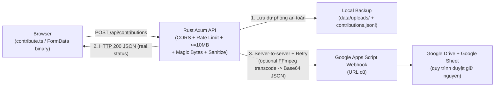

# Kế hoạch Tối ưu hóa bằng Rust — `tudien-xedang`

**Mục tiêu:** Giữ nguyên kiến trúc Web PWA thuần (`fix/audit-remediation` @ `1cb595e`, `16` test files / `109` tests pass, `main.js` `79.59 kB`) và tối ưu 2 thành phần ngoài trình duyệt bằng Rust:
1. **Mục 1 — Rust CLI nén & chuẩn hóa kho âm thanh offline (`tools/audio-optimizer/`):** Tối ưu `1,261` file `.webm` trong `public/audio/` bằng Opus VoIP mono `24 kbps` + `loudnorm`, **không sửa code frontend**.
2. **Mục 2 — Rust Axum Contribute Gateway (`services/contribute-api/`, Phương án A2):** Nhận upload binary `multipart/form-data`, kiểm tra magic bytes & dung lượng, lưu dự phòng cục bộ và chuyển tiếp server-to-server sang Google Apps Script URL hiện có để dữ liệu vẫn đổ vào **Google Sheet + Google Drive** như cũ (không cần Google Service Account).

**Môi trường đã xác minh trên máy:**
- `rustc 1.99.0`, `cargo 1.99.0` (target `x86_64-pc-windows-msvc`)
- `ffmpeg 9.0.2`, `ffprobe 9.0.2`

**Ràng buộc toàn cục:**
- **Zero UI Change:** Không thay đổi UI, luồng ghi âm đơn/hàng loạt hay 6 trường đóng góp ở `contribute.ts`, `recorder.ts`, `batch-queue.ts`.
- **100% Backward Compatible:** Khi web chưa đặt `VITE_CONTRIBUTE_API_URL`, `sendContribution()` tự động dùng nhánh Google Apps Script cũ không gây lỗi.
- **Zero Comments (Rule 1.8):** Không viết comment trong mã nguồn mới/sửa khi triển khai.
- **Dependency Gate:** Mục 1 dùng **0 crate ngoài**; Mục 2 chỉ cài crate Rust khi được xác nhận trước bước thực thi.

---

## Tác động lên hệ thống hiện tại (Trước vs Sau)

| Hạng mục | Hiện tại (`1cb595e`) | Sau khi áp dụng Rust | Tác động code & dữ liệu |
| :--- | :--- | :--- | :--- |
| **Kho âm thanh `public/audio/`** | `1,264` file = `40,623,678 B` (`1,261` `.webm` = `40,379,824 B`, Opus `48 kHz` `132–143 kbps`, TB `32,022 B`/file; `2` `.mp3` = `243,853 B`; `README.md`) | Giữ nguyên `<driveId>.webm`, chuyển về Opus VoIP mono `24 kbps` + `loudnorm`; giữ nguyên `2` file `.mp3` & `README.md` | **0 dòng** sửa ở frontend, URL, Service Worker hay test; dự kiến giảm còn **~8–10 MB** (**-75% đến -80%**) |
| **Luồng gửi đóng góp (`offline-sync.service.ts`)** | Trình duyệt encode Base64 JSON (+33% payload) và `fetch(..., { mode: 'no-cors' })` thẳng sang Google Apps Script | Trình duyệt gửi `FormData` binary lên Rust Axum Gateway → Axum xác thực, lưu dự phòng và chuyển tiếp server-to-server sang Apps Script URL cũ | **~30 dòng** thay đổi ở `config.ts`, `offline-sync.service.ts`, `vite.config.ts`, `.env.example`; bỏ giới hạn mù trạng thái của `no-cors` |
| **Lưu trữ cuối (Google Sheet + Drive)** | Apps Script ghi dòng mới vào Sheet & lưu audio lên Drive | Không đổi: Rust Axum chuyển payload hợp lệ tới chính Apps Script Webhook cũ | Giữ nguyên quy trình kiểm duyệt từ vựng & âm thanh hiện có |

---

## Giai đoạn 1 — Rust CLI tối ưu âm thanh offline (`tools/audio-optimizer/`)

### Files dự kiến
- **Tạo:**
  - `tools/audio-optimizer/Cargo.toml` (`[dependencies]` rỗng — **0 crate ngoài**)
  - `tools/audio-optimizer/src/main.rs`
- **Cập nhật khi triển khai:**
  - `.gitignore`, `.graphifyignore`: thêm `tools/audio-optimizer/target/`

### Thiết kế kỹ thuật
- **Song song hóa stdlib:** Dùng `std::thread::scope` + `std::sync::atomic::AtomicUsize` chia worker theo `std::thread::available_parallelism()` (cho phép ghi đè qua `--jobs N`).
- **Tham số CLI dự kiến:**
  - `--input <dir>` (mặc định `public/audio`)
  - `--bitrate <rate>` (mặc định `24k`, hỗ trợ `32k`)
  - `--no-loudnorm` (mặc định **bật** `-af loudnorm=I=-16:TP=-1.5:LRA=11`)
  - `--dry-run` (quét và thống kê, không ghi file)
  - `--sample <N>` (chạy thử `N` file — mặc định thử `10` file ra thư mục mẫu trước khi chạy hàng loạt)
  - `--keep-backup <dir>` (tùy chọn sao lưu bản gốc trước khi thay)
- **Pipeline an toàn cho từng file `.webm`:**
  1. Bỏ qua mọi file không có đuôi `.webm` (`coi.mp3`, `huongdan.mp3`, `README.md`).
  2. Gọi `ffprobe -v error -select_streams a:0 -show_entries stream=codec_name:format=duration,size -of json <input>` đọc thông số gốc.
  3. Chạy `ffmpeg -y -i <input> -vn -ac 1 -c:a libopus -b:a 24k -vbr on -application voip [-af loudnorm=I=-16:TP=-1.5:LRA=11] -f webm <tmp>.webm`.
  4. Xác minh `<tmp>.webm` qua `ffprobe`: file tồn tại, kích thước `> 0`, `codec_name == "opus"`, độ lệch `duration` nằm trong ngưỡng hợp lệ.
  5. **Thay thế nguyên tử có điều kiện:** Chỉ ghi đè file gốc khi `new_size < old_size`; nếu lỗi `ffprobe`/`ffmpeg` hoặc file mới lớn hơn file cũ → xóa file tạm, giữ nguyên file gốc và ghi nhận lý do vào báo cáo.
  6. In tổng kết: số file thành công / giữ nguyên / lỗi, tổng dung lượng trước vs sau (bytes & MB), `%` tiết kiệm, thời gian chạy.

### Kiểm thử & Rollback Giai đoạn 1
- [x] Unit test bằng `cargo test` trong `tools/audio-optimizer/`: lọc chỉ `.webm`, bỏ qua `.mp3`/`README.md`, từ chối ghi đè khi file sau nén không nhỏ hơn file gốc hoặc lỗi `duration`, xử lý tên file dài/ký tự đặc biệt (`6 passed; 0 failed`).
- [x] Chạy thử `--dry-run` (`1,261` file = `40,379,824 B`), sau đó `--sample 10` (`328,502 B` → `68,920 B`, tiết kiệm `79.02%`) rồi chạy toàn bộ `1,261` file (`40,379,824 B` → `8,626,087 B`, tiết kiệm `31,753,737 B` / `78.64%`, `0` skipped, `0` failed).
- [x] Chạy lại `npx tsc --noEmit && npm test && npm run build` xác nhận toàn bộ web PWA (`16` files / `112` tests) và SW precache không bị ảnh hưởng.
- **Rollback:** Khôi phục tức thì qua `git checkout -- public/audio`.

---

## Giai đoạn 2 — Rust Axum Contribute Gateway (`services/contribute-api/` + Frontend, Phương án A2)

### Luồng dữ liệu Phương án A2

### Dependency Gate (chỉ thêm khi được xác nhận triển khai Giai đoạn 2)
- `axum = { version = "0.8", features = ["multipart"] }`
- `tokio = { version = "1", features = ["macros", "rt-multi-thread", "fs", "net", "time", "signal"] }`
- `tower-http = { version = "0.6", features = ["cors", "limit", "trace"] }`
- `serde = { version = "1", features = ["derive"] }` và `serde_json = "1"`
- `reqwest = { version = "0.12", default-features = false, features = ["rustls-tls", "json"] }`
- Base64 encoder tự viết theo RFC 4648 (~25 dòng Rust thuần) để gửi sang Apps Script mà không cần thêm crate (hoặc dùng `base64 = "0.22"` nếu ưu tiên chuẩn hóa sẵn).

### Files dự kiến
- **Backend Rust mới (`services/contribute-api/`):**
  - `services/contribute-api/Cargo.toml`
  - `services/contribute-api/src/main.rs`: Router Axum, `RequestBodyLimitLayer`, `CorsLayer` theo env, rate limit theo IP, worker nền thử gửi lại bản ghi `queued`/`failed`.
  - `services/contribute-api/src/validation.rs`: Kiểm tra kích thước cứng `<= 10 MB`, xác thực **magic bytes** (`WebM` `1A 45 DF A3`, `MP4/M4A` `ftyp`, `OGG` `OggS`, `MP3` `ID3` / frame sync `FF FB|F3|F2`, `WAV` `RIFF....WAVE`, `FLAC` `fLaC`), lọc tên file an toàn chống path traversal.
  - `services/contribute-api/src/storage.rs`: Lưu binary vào `DATA_DIR/uploads/` và ghi metadata + trạng thái (`queued` / `synced` / `failed`) vào `DATA_DIR/contributions.jsonl`.
  - `services/contribute-api/src/forwarder.rs`: (Tùy chọn chạy FFmpeg nén Opus nhẹ hơn trước khi gửi) chuyển tiếp JSON `{ type, vietnamese, xodang, readingContent, audioData, mimeType, filename }` tới `APPS_SCRIPT_WEBHOOK_URL` kèm exponential backoff retry.
  - `services/contribute-api/Dockerfile` & `services/contribute-api/.env.example`.
- **Cập nhật tối thiểu phía Frontend & Repo:**
  - `src/shared/constants/config.ts`: Thêm `CONTRIBUTE_API_URL: viteEnv.VITE_CONTRIBUTE_API_URL || APP_CONFIG.CONTRIBUTE_URL`.
  - `src/renderer/services/offline-sync.service.ts`: Khi `APP_CONFIG.CONTRIBUTE_API_URL` trỏ khác URL Apps Script mặc định → `sendContribution()` gửi `FormData` binary (`type`, `vietnamese`, `xodang`, `readingContent`, `filename`, `audio`) bỏ `mode: 'no-cors'`, kiểm tra `res.ok` và ném lỗi thật khi server trả `4xx/5xx`; ngược lại giữ nguyên nhánh Apps Script cũ.
  - `vite.config.ts`: Đọc origin từ `process.env.VITE_CONTRIBUTE_API_URL` (nếu có) bổ sung vào CSP `connect-src`.
  - `.env.example`: Thêm `VITE_CONTRIBUTE_API_URL=https://YOUR_CONTRIBUTE_API_DOMAIN/api/contributions`.
  - `.gitignore` & `.graphifyignore`: Thêm `services/contribute-api/target/`, `services/contribute-api/data/`.
  - `tests/audio.test.ts`, `tests/contribute.test.ts`: Phủ nhánh upload `FormData` thành công (`200`), báo lỗi thật (`413`/`415`/`500`), và nhánh fallback Apps Script khi chưa set env.

### API Contract & Biến môi trường Server
- **Endpoints:**
  - `GET /health` → `200 OK { "status": "ok", "queued": <n> }`
  - `POST /api/contributions` (`multipart/form-data`: `type`, `vietnamese`, `xodang`, `readingContent`, `filename`, `audio`):
    - `200 OK` (`FORWARD_MODE=sync`) hoặc `202 Accepted` (`FORWARD_MODE=async`): `{ "success": true, "id": "...", "filename": "...", "size": <bytes>, "syncStatus": "synced|queued", "message": "..." }`
    - `400 Bad Request`: Thiếu `audio` hoặc thiếu `vietnamese`/`xodang` (khi `type=vocab`)
    - `413 Payload Too Large`: Vượt `MAX_UPLOAD_BYTES` (`10,485,760` bytes)
    - `415 Unsupported Media Type`: Magic bytes không khớp định dạng audio hợp lệ
    - `429 Too Many Requests`: Vượt ngưỡng rate limit theo IP
    - `502 Bad Gateway`: Khi `FORWARD_MODE=sync` mà Apps Script trả lỗi (file vẫn được lưu trong `data/`)
- **Env phía server (`services/contribute-api/.env.example`):**
  - `PORT=8080`
  - `ALLOWED_ORIGINS=https://yourdomain.github.io,http://localhost:3000`
  - `DATA_DIR=./data`
  - `MAX_UPLOAD_BYTES=10485760`
  - `APPS_SCRIPT_WEBHOOK_URL=<URL Apps Script hiện có>`
  - `FORWARD_MODE=async` (`sync` | `async`)
  - `TRANSCODE_BEFORE_FORWARD=false`

### Kiểm thử Giai đoạn 2 & Lộ trình nâng cấp A2 → A1
- [x] `cargo test` trong `services/contribute-api/`: test upload WebM/MP4/MP3 hợp lệ, test file giả mạo (`415`), quá `10 MB` (`413`), tên file `../../etc/passwd` bị sanitize, mock webhook Apps Script thành công & retry khi lỗi, test rate limit (`429`) & CORS preflight (`8 passed; 0 failed`, `cargo clippy -- -D warnings` exit 0).
- [x] `npx tsc --noEmit && npx tsc -p tsconfig.node.json --noEmit && npm test && npm run build`.
- **Nâng cấp A2 → A1 sau này (nếu cần):** Chỉ cần thay phần thân module `forwarder.rs` sang gọi Google Drive API v3 + Google Sheets API v4 bằng Service Account JWT; giữ nguyên toàn bộ API Contract, Storage và Frontend.

---

## 5 Kịch bản Biên bắt buộc phải phủ test
1. **File gốc hỏng / 0 byte / lệch thời lượng trong `public/audio/`:** CLI phát hiện qua `ffprobe` và giữ nguyên file gốc, không ghi đè.
2. **File sau nén lớn hơn file gốc:** CLI bỏ qua, xóa file tạm và giữ file gốc nhỏ hơn.
3. **Upload file giả mạo phần mở rộng (`.webm` chứa HTML/EXE):** Rust Axum chặn bằng kiểm tra magic bytes (`415`) trước khi lưu hay đẩy sang Apps Script.
4. **Google Apps Script timeout hoặc lỗi mạng tạm thời:** Rust Axum vẫn lưu file + metadata vào `data/` với trạng thái `queued`/`failed` để retry, không mất đóng góp của người dùng.
5. **Chưa cấu hình `VITE_CONTRIBUTE_API_URL`:** Frontend tự động dùng fallback Apps Script cũ (`no-cors`), hoạt động bình thường không lỗi.
