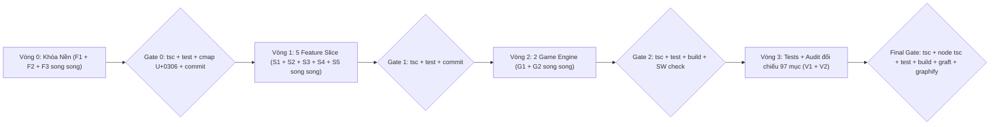

# Kế Hoạch Triển Khai Sửa Toàn Diện UI/UX, Game Arena & Trạng Thái (`tudien-xedang`)

- **Tài liệu nguồn:** [ui-audit-checklist.md](./ui-audit-checklist.md) (`97` mục: `14 P0 · 40 P1 · 28 P2 · 8 P3 · 7 GAME Redesign`)
- **Kiến trúc thực thi:** **DAG 4 vòng — 12 subagent**, khóa quyền ghi tệp độc quyền theo từng vòng (`0` trùng tệp, `0` merge conflict), chốt contract nền trước khi mở rộng song song.
- **Trạng thái hiện tại:** **Chưa chỉnh sửa mã nguồn ứng dụng** — tài liệu này khóa thiết kế, phạm vi tệp và cổng kiểm định trước khi thực thi.

---

## 1. Mục tiêu, Phạm vi & Ràng buộc toàn cục

1. **Mục tiêu:** Xử lý triệt để toàn bộ **97/97 mục** (`UI-01`..`UI-22`, `GAME-01`..`GAME-07`, `VIS-01`..`VIS-18`, `UX-01`..`UX-31`, `GM-01`..`GM-19`) mà không phát sinh hồi quy chức năng, không trùng lặp xung đột khi chạy song song nhiều subagent.
2. **Git Safety:** Khi bắt đầu thực thi, tạo nhánh riêng `fix/ui-audit-97` từ `main`; commit 1 checkpoint sau mỗi vòng vượt qua cổng kiểm định; tuyệt đối không commit trực tiếp lên `main`.
3. **Zero Comments & Ponytail Minimalism:** Không viết comment (`//`, `/* */`, HTML comment) trong mã nguồn mới/sửa; xóa comment ở vùng chạm tới; tái sử dụng helper dùng chung, không tạo abstraction thừa.
4. **Zero Unapproved Dependencies:** Không tự ý cài package npm hay Rust crate mới; font **Be Vietnam Pro** dùng tài nguyên `.woff2` self-host tĩnh đặt trong `public/fonts/be-vietnam-pro/`.
5. **Production CSP Strictness ([vite.config.ts](../vite.config.ts#L78)):**
   - Bản build production ép `<meta http-equiv="Content-Security-Policy">` với `script-src 'self' 'wasm-unsafe-eval' https://cdn.jsdelivr.net` (**không có `'unsafe-inline'`**) và `font-src 'self'`.
   - Do đó:
     - Script chống chớp trắng Dark Mode (`UI-13`) **BẮT BUỘC** tách ra tệp ngoài `public/theme-init.js` (``) và đưa vào `STATIC_PRECACHE` — cấm nhúng inline script trong [index.html](../index.html).
     - Font **Be Vietnam Pro** **BẮT BUỘC** self-host cục bộ tại `public/fonts/be-vietnam-pro/`, không gọi Google Fonts CDN.
6. **Zero-Regression Test Contracts:** Bảo toàn (hoặc nâng cấp kèm test đối ứng tại Vòng 3) các hợp đồng kiểm thử hiện có:
   - [minimal-redesign-verification.test.ts](../tests/integration/minimal-redesign-verification.test.ts) (Direction A Warm Paper & Graphite tokens)
   - [legacy-storage.test.ts](../tests/unit/legacy-storage.test.ts) (giữ tương thích đọc/migrate `studyProgressByTopic` dạng chỉ số cũ sang `q.id`)
   - [service-worker.test.ts](../tests/integration/service-worker.test.ts) (`STATIC_PRECACHE` hợp lệ, `dist/service-worker.js` `0` `import`/`export`)
   - [xss-security.test.ts](../tests/security/xss-security.test.ts), [smoke.test.ts](../tests/security/smoke.test.ts)
   - [golden-search.test.ts](../tests/unit/golden-search.test.ts), [unicode-nfc.test.ts](../tests/unit/unicode-nfc.test.ts), [speech.test.ts](../tests/unit/speech.test.ts), [router.test.ts](../tests/unit/router.test.ts), [audio.test.ts](../tests/unit/audio.test.ts), [faq.test.ts](../tests/unit/faq.test.ts)
   - [quiz.test.ts](../tests/features/quiz.test.ts), [contribute.test.ts](../tests/features/contribute.test.ts), [games.test.ts](../tests/features/games.test.ts), [games-ancillary.test.ts](../tests/features/games-ancillary.test.ts), [onboarding.test.ts](../tests/features/onboarding.test.ts)

---

## 2. 3 Quyết định Kiến trúc Đã Chốt

### Quyết định 1 — Đồng bộ ngữ liệu theo Google Sheet chính (`[GM-01]`, `[GM-12]`)
- Nâng cấp [generate-snapshot.ts](../scripts/generate-snapshot.ts) để kéo dữ liệu thật từ Google Sheets (`Tu_Dien!A2:F`, `Data_Tracnghiem!A2:H`, `Data_Chat!A2:B`), đối chiếu cột `driveId` với [audio-pack.index.json](../public/audio-pack.index.json) (chỉ giữ ID thực sự tồn tại trong gói audio offline, lọc bỏ ID ảo).
- Ghi đồng bộ cả `src/shared/data/snapshot/*.json` (cho Vite virtual plugin `snapshot-data-resolver` tại [vite.config.ts](../vite.config.ts#L15-L52)) lẫn cập nhật tập dự phòng chuẩn trong [snapshot-fallback.ts](../src/shared/data/snapshot-fallback.ts) để không còn mâu thuẫn **Bố (`Bá` vs `mê`) / Mẹ (`Mế` vs `mẹ`)**, `Cơm`, `Uống`, `Con trâu`, `Con bò`, `Mặt trời`, `Mặt trăng`, và xóa sạch 20 `driveId` giả `audio_1`..`audio_20`.
- Trên [game-data.ts](../src/features/games/game-data.ts): loại bỏ `BASELINE_GAME_VOCAB` đối nghịch, dùng nguồn chuẩn từ `snapshotFallback.dictionary` (Single Source of Truth) và hạ ngưỡng dùng từ điển trực tiếp xuống `>= 4` mục hợp lệ.
- *Lưu ý vận hành lúc thực thi Vòng 0:* Cần biến môi trường `GOOGLE_SHEETS_API_KEY` (hoặc `VITE_GOOGLE_API_KEY`) trong `.env` để chạy `npm run snapshot` ngoài sandbox; nếu thiếu key ở môi trường chạy, dừng nhắc người dùng bổ sung trước khi sinh snapshot.

### Quyết định 2 — Font self-host `Be Vietnam Pro` hỗ trợ dấu Xơ Đăng (`[VIS-09]`, `[VIS-18]`, `[GM-15]`)
- Tải tĩnh bộ font **Be Vietnam Pro** (weight `400`, `500`, `600`, `700` phủ `vietnamese` + `latin-ext` + `latin` + dải Combining Diacritics `U+0300–U+036F`, đặc biệt `U+0306` cho `Ơ̆/Ư̆/ơ̆/ư̆/ê̆`, loại bỏ hoàn toàn block `cyrillic-ext`) vào `public/fonts/be-vietnam-pro/` kèm stylesheet `public/fonts/be-vietnam-pro/be-vietnam-pro.css`.
- Tại **Gate 0**, kiểm tra trực tiếp bảng glyph `cmap` của các tệp `.woff2` để đảm bảo ký tự tổ hợp `U+0306` hoạt động trên chuỗi NFD (`Ơ̆`, `Ư̆`, `ê̆`); nếu bản cắt Google Fonts tách dấu tổ hợp rời, dùng bản `.woff2` không strip combining mark.
- Cập nhật đồng bộ [index.html](../index.html), [tokens.css](../src/styles/tokens.css) (`--font-sans`), [home.css](../src/styles/features/home.css) (`.pronunciation`), [offline.html](../public/offline.html), [certificate.ts](../src/features/games/certificate.ts), và `STATIC_PRECACHE` trong [service-worker.ts](../src/service-worker.ts) (precache đủ toàn bộ `vietnamese`, `latin-ext`, `latin` cho 4 weight `400/500/600/700`).

### Quyết định 3 — Dựng Outbox IndexedDB cho Đóng góp Offline (`[UX-12]`)
- Tạo mới `src/services/contribution-outbox.service.ts` dựa trên IndexedDB (`dbName: 'tudien-xedang-outbox'`, object store `'contributions'`, `keyPath: 'id'`), lưu trực tiếp `Blob` âm thanh gốc (tái sử dụng cấu trúc `ContributionItem` tại [offline-sync.service.ts](../src/services/offline-sync.service.ts#L5-L14), không mã hóa Base64 phình `localStorage`).
- Giới hạn dung lượng an toàn: tối đa `25` mục / `50 MB`; có fallback sạch nếu trình duyệt ẩn danh/chặn IndexedDB.
- Tách hằng số `UPLOAD_TIMEOUT_MS = 45000` tại [config.ts](../src/shared/constants/config.ts#L15) cho `sendContribution()` (giữ `REQUEST_TIMEOUT_MS = 8000` cho truy vấn Google Sheets).
- Quy trình vận hành:
  1. Khi `!navigator.onLine` hoặc gửi bị lỗi mạng/timeout (`TypeError`/`AbortError`), tự động xếp bản ghi vào Outbox và thông báo rõ *"Đang offline — đã lưu vào hàng đợi, sẽ tự đồng bộ khi có mạng"*.
  2. Khi kích hoạt `window.online` hoặc lúc khởi động app (nếu đang online), chạy `flushContributionOutbox()` (FIFO, khóa `isFlushing`, xóa từng mục ngay khi upload xong) và phát `eventBus.emit('outbox:change', remainingCount)`.
  3. Tại tab Đóng góp (`#contribute`), hiển thị thanh trạng thái số bản ghi đang chờ đồng bộ + nút `"Đồng bộ ngay"`.
  4. Khi gửi qua Apps Script `mode: 'no-cors'`, dùng thông báo trung thực với bản chất opaque response (khi dùng `VITE_CONTRIBUTE_API_URL` có CORS mới xác nhận lưu thành công).

---

## 3. Kiến trúc DAG 4 Vòng & Hợp đồng Dùng Chung

### Hợp đồng khóa tại Vòng 0 (Contract-First)
Tất cả subagent Vòng 1–2 dùng đúng tên biến/API dưới đây để khớp nhau ngay lần đầu:
1. **CSS Tokens & Z-Index Ladder ([tokens.css](../src/styles/tokens.css)):**
   - Gắn theme trên `:root.dark-mode` kèm tương thích ngược `body.dark-mode`; khai báo `:root { color-scheme: light; }` và `:root.dark-mode { color-scheme: dark; }`.
   - Thang `z-index`: `--z-nav: 100`, `--z-fab: 200`, `--z-chat: 300`, `--z-offline: 400`, `--z-modal: 1000`, `--z-loading: 1100`, `--z-toast: 1200`.
   - Tương phản & biến ngữ nghĩa: dùng `var(--text-inverse)` (`#ffffff` Light / `#0f1012` Dark) trên CTA/huy hiệu; thêm `--color-danger-bg`, `--color-danger-light`, `--color-warning-light`, `--bg-overlay`; hiệu chỉnh `--text-tertiary` đạt `>= 4.5:1` trên bề mặt nổi; xóa biến mồ côi `--bg-card-dark`.
   - Tiền tố class chống va chạm cross-chunk: `.chat-suggestion-btn` (tách khỏi `.hashtag`), `.contribute-modal-btn`, `.game-modal-btn`, `.ios-step-num`, `.guide-step-num`, `.home-loading`.
2. **Modal Accessibility Helper (`src/utils/modal-a11y.ts`):**
   - `openAccessibleModal(modalEl, options?: { onClose?: () => void; initialFocus?: HTMLElement | null; labelledById?: string })`
   - `closeAccessibleModal(modalEl)` — xử lý thống nhất phím `Escape`, focus trap vòng `Tab`/`Shift+Tab`, khóa cuộn trang `body` (đếm số modal mở chồng), và trả focus về nút kích hoạt khi đóng.
3. **Contribution Outbox API (`src/services/contribution-outbox.service.ts`):**
   - `enqueueContribution(item)`, `getOutboxCount()`, `listOutboxItems()`, `removeOutboxItem(id)`, `flushContributionOutbox()` → trả `{ sent: number; failed: number; remaining: number }`, tự phát `eventBus.emit('outbox:change', remaining)`.
4. **Game Core API ([game-data.ts](../src/features/games/game-data.ts), [sound-effects.ts](../src/features/games/sound-effects.ts)):**
   - `GameWordPair`: `{ ethnic: string; viet: string; pronunciation?: string; driveId?: string; topic?: string; difficulty?: 1 | 2 | 3 }`.
   - `GameQuestion`: bổ sung `driveId?: string; pronunciation?: string; direction: 'ethnic_to_viet' | 'viet_to_ethnic'`.
   - `DestroyableGame`: bổ sung `pause?(): void`, `resume?(): void`, `getMistakes?(): GameWordPair[]`.
   - `GameCallbacks`: bổ sung `onProgressChange?(current: number, total: number): void`, `onComboChange?(combo: number): void`, `onMistake?(pair: GameWordPair): void`.
   - `soundEffects`: lập lịch theo `ctx.currentTime`, xử lý mọi trạng thái `ctx.state !== 'running'` (gồm `'interrupted'` iOS Safari), master `GainNode`, `duckForAudio(durationMs)` khi phát audio bản địa.

---

## 4. Phân công Chi tiết 4 Vòng — 12 Subagent (97/97 Mục · 0 Trùng File)

### Vòng 0 — Khóa Contract Nền & Hạ tầng (3 Subagent Song Song)

| Agent | Quyền ghi tệp độc quyền | Mục checklist xử lý | Trọng tâm triển khai |
| :--- | :--- | :--- | :--- |
| **F1 — Design Tokens & Core CSS** | [tokens.css](../src/styles/tokens.css), [base.css](../src/styles/base.css), [layout.css](../src/styles/layout.css), [common.css](../src/styles/components/common.css), [modal.css](../src/styles/components/modal.css), [tokens.json](./design/tokens.json), [dark-mode-tokens.json](./design/dark-mode-tokens.json), [dark-mode-tokens.md](./design/dark-mode-tokens.md), [dark-mode-themes.css](./design/dark-mode-themes.css) | `UI-01`, `UI-02`, `UI-03`, `UI-05`, `UI-07`, `UI-14`, `UI-18`, `UI-20`, `VIS-02`, `VIS-04`, `VIS-05`, `VIS-06`, `VIS-07`, `VIS-08`, `VIS-09`, `VIS-11`, `VIS-13`, `VIS-14`, `VIS-17`, `UX-31` | Chốt `:root.dark-mode` + `color-scheme`, thang `--z-*`, `--font-sans` sang `'Be Vietnam Pro'`, sửa `--text-inverse` / `--text-tertiary` / `.toast.*` (kèm `.toast.warning`, stack flex, `max-width`) / `.offline-indicator` (`pointer-events: none; visibility: hidden; .online`), bỏ ép `20px` trên `.lucide-icon`, sửa `.mobile-bottom-nav` `min-height` + `safe-area-inset-bottom`, `padding-top: env(safe-area-inset-top)` trên `.navbar`, khôi phục `:focus-visible`, `@media (prefers-reduced-motion: reduce)`, `100dvh` + scroll modal, xóa `.loading` thừa & đồng bộ spec `docs/design/*`. |
| **F2 — App Shell, Router, Navbar, Install, Offline Page & PWA/Font** | [index.html](../index.html), `public/theme-init.js` *(mới)*, `public/fonts/be-vietnam-pro/*` *(mới)*, [manifest.json](../public/manifest.json), [offline.html](../public/offline.html), [service-worker.ts](../src/service-worker.ts), [main.ts](../src/main.ts), [router.ts](../src/router.ts), `src/utils/modal-a11y.ts` *(mới)*, [toast.ts](../src/components/toast.ts), [offline-indicator.ts](../src/components/offline-indicator.ts), [loading-overlay.ts](../src/components/loading-overlay.ts), [navbar.html](../src/components/navbar/navbar.html), [navbar.ts](../src/components/navbar/navbar.ts), [install-modal.html](../src/components/install-modal/install-modal.html), [install-modal.ts](../src/components/install-modal/install-modal.ts), [footer.html](../src/components/footer/footer.html) | `UI-10`, `UI-11`, `UI-12`, `UI-13`, `UI-16`, `UI-19`, `UI-22`, `VIS-04`, `VIS-05`, `VIS-06`, `VIS-07`, `VIS-09`, `VIS-10`, `VIS-16`, `VIS-18`, `UX-02`, `UX-03`, `UX-12`, `UX-14`, `UX-16`, `UX-17`, `UX-18`, `UX-29`, `UX-30`, `UX-31` | Đặt `public/theme-init.js` tuân thủ CSP (gắn `dark-mode` + cập nhật `<meta name="theme-color">`, `viewport-fit=cover`, đổi `apple-mobile-web-app-status-bar-style`), dựng font `Be Vietnam Pro` self-host (không `cyrillic-ext`), precache đủ font + `theme-init.js` trong `STATIC_PRECACHE`, sửa `manifest.json`, sửa toàn diện `offline.html`, đồng bộ skeleton `index.html` khớp `.lexical-summary-bar`, sửa `bootstrap()` + lazy-route loader/catch + race `#chatToggleBtn`, chuẩn hóa `router.ts` (`.toLowerCase()` + `?`), đưa `.mobile-bottom-nav` ra ngoài `<nav>`, thêm nút Hướng dẫn mở Onboarding, xây `modal-a11y.ts` + nối `install-modal`, `offline-indicator.ts` + `toast.ts`, và móc `flushContributionOutbox()` vào sự kiện `online`. |
| **F3 — Sheet Snapshot, Cache, Outbox IndexedDB & Game Core** | [generate-snapshot.ts](../scripts/generate-snapshot.ts), [config.ts](../src/shared/constants/config.ts), [snapshot-fallback.ts](../src/shared/data/snapshot-fallback.ts), [storage.service.ts](../src/services/storage.service.ts), [sheets.service.ts](../src/services/sheets.service.ts), `src/services/contribution-outbox.service.ts` *(mới)*, [game-data.ts](../src/features/games/game-data.ts), [sound-effects.ts](../src/features/games/sound-effects.ts) | `GAME-02`, `GAME-04`, `UX-12`, `UX-23`, `GM-01`, `GM-07`, `GM-11`, `GM-12`, `GM-17` | Đồng bộ ngữ liệu từ Google Sheet (`npm run snapshot`) lọc `driveId` thật từ `audio-pack.index.json`, thống nhất nguồn `snapshotFallback.dictionary` (sửa `Bố/Mẹ` + xóa `audio_1..20`), nâng cấp `game-data.ts` (giữ `driveId` + `pronunciation`, sắp độ khó, luyện 2 chiều, khử trùng NFC/đa nghĩa, chặn rỗng `getMemoryCardPairs`, bỏ `(1)..(10)`), dựng IndexedDB `contribution-outbox.service.ts` + `UPLOAD_TIMEOUT_MS = 45000`, sửa fast-path `!navigator.onLine` + TTL cache ở `sheets.service.ts`, viết lại `sound-effects.ts` chuẩn `ctx.currentTime` + iOS `'interrupted'`. |

- **Gate 0:** Chạy `npx tsc --noEmit` + `npm test` + kiểm tra glyph `U+0306` trong `be-vietnam-pro` → commit `chore(audit): wave 0 foundation contracts`.

---

### Vòng 1 — 5 Feature Slice Song Song (0 File Trùng)

| Agent | Quyền ghi tệp độc quyền | Mục checklist xử lý | Trọng tâm triển khai |
| :--- | :--- | :--- | :--- |
| **S1 — Home, Search, Audio & STT 3 tầng** | [home.html](../src/features/home/home.html), [home.ts](../src/features/home/home.ts), [word-card.ts](../src/features/home/word-card.ts), [home.css](../src/styles/features/home.css), [speech.service.ts](../src/services/speech.service.ts), [whisper-stt.service.ts](../src/services/whisper-stt.service.ts), [whisper-stt.worker.ts](../src/services/whisper-stt.worker.ts), [dictionary.service.ts](../src/services/dictionary.service.ts), [offline-sync.service.ts](../src/services/offline-sync.service.ts) | `UI-01`, `UI-07`, `UI-17`, `UI-20`, `UI-21`, `UI-22`, `VIS-09`, `VIS-12`, `VIS-13`, `VIS-15`, `UX-04`, `UX-05`, `UX-06`, `UX-07`, `UX-19`, `UX-20`, `UX-21`, `UX-22` | Nút xóa nhanh (Clear) `#word`, sửa CTA download Dark Mode, sửa `matchType` + chính tả `"Xơ Đăng"` + lọc `'null'` ở `word-card.ts`, điều phối 1 `<audio>` phát tại 1 thời điểm + dừng khi đổi tab + `onerror`, sửa STT state machine (`cancel()`, hướng `vi-VN` tự khớp chiều, sửa stale `STT_WASM_READY`), thay `<datalist>` bằng combobox ARIA không dấu + 1-char live search, đổi chip theo `#direction`, giữ huy hiệu sau đồng bộ audio offline + chặn khi `!navigator.onLine`, `.pronunciation` dùng `var(--font-sans)` & tương phản `#9c4215`. |
| **S2 — Quiz & Flashcard** | [quiz.html](../src/features/quiz/quiz.html), [quiz.ts](../src/features/quiz/quiz.ts), [flashcard.ts](../src/features/quiz/flashcard.ts), [quiz.service.ts](../src/services/quiz.service.ts), [quiz.css](../src/styles/features/quiz.css), [flashcard.css](../src/styles/features/flashcard.css) | `UI-01`, `UI-04`, `UI-09`, `UI-12`, `VIS-03`, `VIS-08`, `VIS-12`, `VIS-15`, `VIS-18`, `UX-08`, `UX-09`, `UX-10`, `UX-18`, `UX-24`, `UX-25`, `UX-26`, `UX-27` | Thêm CSS `.study-progress-bar` / `.study-progress-fill`, đổi `.step-num` → `.guide-step-num`, nút "Quay lại chủ đề", sửa `#retryQuizBtn` thi lại ngay + resume `#quizTimer` qua `tab:change` + reset `00:00` tức thì, chuyển `.topic-card` / `.option` / `#flashcard` sang `<button>`/`role="radio"` đủ phím + không hủy DOM khi chọn đáp án, lọc rỗng + xáo trộn A/B/C/D + bỏ emoji trong `quiz.service.ts`, migrate `studiedCards` theo `q.id` (chống >100%) + sửa lộ mặt sau flashcard khi chuyển thẻ + `line-height: 1.6`. |
| **S3 — Đóng góp, Ghi âm & Giao diện Outbox** | [contribute.html](../src/features/contribute/contribute.html), [contribute.ts](../src/features/contribute/contribute.ts), [recorder.ts](../src/features/contribute/recorder.ts), [batch-queue.ts](../src/features/contribute/batch-queue.ts), [visualizer.ts](../src/features/contribute/visualizer.ts), [contribute.css](../src/styles/features/contribute.css) | `UI-01`, `UI-11`, `UI-12`, `UI-22`, `VIS-02`, `VIS-08`, `VIS-11`, `UX-01`, `UX-11`, `UX-12`, `UX-13`, `UX-28` | Thêm ô nhập/sửa từ Việt & Xơ Đăng cho từng mục Thu hàng loạt (`UX-01`), thanh ký tự Xơ Đăng (`Ŏ Ŭ Ĕ...`) cho Đóng góp, nối `openAccessibleModal` cho `#deleteAudioConfirmModal`, đổi `.modal-btn` → `.contribute-modal-btn`, sửa chữ trên nền `--color-danger` Dark Mode, bọc `<form>` + bộ đếm/giới hạn thu âm + đuôi theo MIME + chống gửi đúp, sửa đủ 6 lỗi state thu/phát audio (`cancel()` khi chuyển tab, pause trước xóa, reset input file, `onerror`), gỡ từng item thành công ở batch + đẩy Outbox offline + hiện badge & nút `"Đồng bộ ngay"`. |
| **S4 — Chat & Onboarding** | [chat.html](../src/features/chat/chat.html), [chat.ts](../src/features/chat/chat.ts), [faq.service.ts](../src/services/faq.service.ts), [chat.css](../src/styles/features/chat.css), [onboarding.html](../src/features/onboarding/onboarding.html), [onboarding.ts](../src/features/onboarding/onboarding.ts), [onboarding.css](../src/styles/features/onboarding.css) | `UI-01`, `UI-06`, `UI-09`, `UI-11`, `UI-17`, `VIS-01`, `VIS-02`, `VIS-11`, `UX-12`, `UX-15`, `UX-16`, `UX-29` | Tách `.chat-suggestion-btn` khỏi `.hashtag`, sửa `.chat-header h3` `color: inherit` + badge thông báo chữ tối Dark Mode, `.chat-window` `width: 100%; height: calc(85dvh - 64px)`, sửa `loadFaqs()` không xóa tin người dùng + đóng `Escape` & `tab:change` mobile + ARIA `role="log"`, nối `openAccessibleModal` + cập nhật động `aria-labelledby` cho Onboarding & nút dot `44×44px` có phím mũi tên + chặn swipe dọc chéo tay (`diffX > diffY`). |
| **S5 — Game Arena Shell, CSS, Bảng vàng & Chứng nhận** | [games.html](../src/features/games/games.html), [games.ts](../src/features/games/games.ts), [leaderboard.ts](../src/features/games/leaderboard.ts), [certificate.ts](../src/features/games/certificate.ts), [games.css](../src/styles/features/games.css) | `UI-01`, `UI-08`, `UI-11`, `UI-14`, `UI-15`, `UI-17`, `UI-20`, `UI-22`, `VIS-08`, `VIS-11`, `VIS-12`, `VIS-13`, `VIS-15`, `VIS-18`, `GAME-01`, `GAME-03`, `GAME-04`, `GAME-05`, `GAME-07`, `GM-03`, `GM-09`, `GM-10`, `GM-13`, `GM-14`, `GM-15`, `GM-16`, `GM-19` | Tái thiết kế Theater/Focus Mode toàn khung + HUD Tiến độ/Combo/Pause/Nghe lại phát âm + thẻ Xem nhanh từ vựng trước màn + Modal tổng kết từ sai cuối màn, sửa nest interactive ở `.game-select-card` + heading `<h2>` + nút đổi tên người chơi, đổi `.modal-btn` → `.game-modal-btn`, giữ điểm cộng dồn qua Level, chỉ cấp Chứng nhận/nâng `level` khi thắng + khử trùng + lọc theo user + tên file NFD chuẩn + Canvas 2x font `'Be Vietnam Pro'` không emoji, đóng cả 4 body modals trong `exitToMenu()`, sửa Dark Mode / contrast AA / hover specificity / modal scroll / `touch-action` & `-webkit-backface-visibility`. |

- **Gate 1:** Chạy `npx tsc --noEmit` + `npm test` → commit `fix(ui): wave 1 parallel feature slices`.

---

### Vòng 2 — 2 Game Engine Song Song (Khớp trực tiếp Arena Shell Vòng 1)

| Agent | Quyền ghi tệp độc quyền | Mục checklist xử lý | Trọng tâm triển khai |
| :--- | :--- | :--- | :--- |
| **G1 — DOM Games (`Game1Memory` & `Game4Farm`)** | [game1-memory.ts](../src/features/games/game1-memory.ts), [game4-farm.ts](../src/features/games/game4-farm.ts) | `UI-09`, `GAME-02`, `GAME-03`, `GAME-04`, `GAME-07`, `GM-06`, `GM-07`, `GM-08`, `GM-18` | Game 1: cập nhật `aria-label` động kèm nội dung & trạng thái lật/ghép + `aria-live`, nhãn ngôn ngữ Xơ Đăng/Việt trên thẻ, phát audio `driveId` khi ghép đúng, khử trùng cặp bằng `vocab` đã chuẩn hóa. Game 4: chuyển `.farm-plot` sang `<button>`, thêm nút Đóng + click backdrop + `Escape`, hàng đợi `>= totalPlots * 3` không lặp + tăng ô theo Level, banner sửa lỗi tức thì khi sai, tracking `mistakes`, dùng Lucide SVG thay emoji, guard rỗng & idempotent `start()`. |
| **G2 — Canvas HiDPI Games (`Game2Catcher` & `Game3Shooter`)** | [game2-catcher.ts](../src/features/games/game2-catcher.ts), [game3-shooter.ts](../src/features/games/game3-shooter.ts) | `GAME-01`, `GAME-02`, `GAME-03`, `GAME-05`, `GAME-06`, `GAME-07`, `VIS-13`, `GM-02`, `GM-04`, `GM-05`, `GM-13`, `GM-18` | Canvas HiDPI tự co giãn theo `ResizeObserver` × `devicePixelRatio`, đọc bảng màu Warm Paper / Graphite từ CSS custom properties, tách 3 làn không chồng + stagger `startY` + `ctx.measureText()` (`>= 48px` pill), sửa hitbox tường Game 3 (`t.y + t.radius >= h - 35`), phân hóa cơ chế Game 3 (thẻ ngang rõ nhịp / tránh đè nhau + hiệu ứng bắn + phím tắt `1/2/3`), hỗ trợ `pause()`/`resume()`, Pointer Events (`pointerdown`/`pointermove`), guard `rect.width > 0` & editable inputs (`#chatInput`), phát `wrong()` + banner sửa lỗi ngắn không chờ 6–8s, nút nghe audio + tracking `mistakes` & guard rỗng. |

- **Gate 2:** Chạy `npx tsc --noEmit` + `npm test` + `npm run build` (xác nhận `dist/service-worker.js` `0` `import`/`export`, `dist/index.html` giữ nguyên CSP strict, đủ font `be-vietnam-pro`) → commit `feat(games): wave 2 arena and engines`.

---

### Vòng 3 — Test Hồi Quy & Audit Đối Chiếu Đủ 97 Mục

| Agent | Quyền ghi tệp độc quyền | Nhiệm vụ chi tiết |
| :--- | :--- | :--- |
| **V1 — Test Engineer** | `tests/unit/*`, `tests/features/*`, `tests/integration/*` | Cập nhật test cũ bị ảnh hưởng có chủ đích (`service-worker.test.ts` với `be-vietnam-pro` + `theme-init.js`; `legacy-storage.test.ts` migration sang `q.id`) và viết unit/feature test khóa chống hồi quy cho mọi lỗi P0/P1 mới (`GM-01` ngữ liệu Bố/Mẹ, `GM-02` không chồng làn, `GM-03` giữ điểm qua Level, `GM-07` crash rỗng, `GM-09`/`GM-10` không cấp bằng khi thua & tách user, `GM-14` tên file NFD, `UX-01` batch labels, `UX-06`/`UX-07` STT `cancel()`, `UX-08` `#retryQuizBtn`, `UX-10` shuffle/lọc rỗng, `UX-11` partial batch, `UX-12` IndexedDB outbox, `UX-13` audio state Đóng góp, `UX-14`/`UX-15` chat race, `UX-18` router, `modal-a11y`). |
| **V2 — Independent Audit Reviewer** | Read-only + đánh dấu `[x]` trên [ui-audit-checklist.md](./ui-audit-checklist.md) | Kiểm tra diff toàn nhánh đối chiếu đủ **97/97 mục**: xác nhận 0 comment trong code, 0 `outline: none`, 0 biến CSS chết, 0 link gãy, tương phản WCAG AA trên cả 2 theme & Canvas, cập nhật `[x]` cho mọi mục đạt chuẩn. |

- **Final Gate (Điều phối chính):** `npx tsc --noEmit`, `npx tsc -p tsconfig.node.json --noEmit`, `npm test`, `npm run build`, `graft build`, `graphify update .`, kiểm `git diff --stat main...HEAD`.

---

## 5. Ma trận Cổng Kiểm Định & Cơ chế Rollback

| Cổng | Thời điểm | Lệnh bắt buộc | Tiêu chí Pass | Rollback nếu lỗi nặng |
| :--- | :--- | :--- | :--- | :--- |
| **Gate 0** | Sau Vòng 0 (`F1–F3`) | `npx tsc --noEmit`, `npm test`, kiểm `cmap` `U+0306` | `0` lỗi TS, `100%` test pass, font có `U+0306` | Sửa đúng agent F1/F2/F3 trước khi mở Vòng 1 |
| **Gate 1** | Sau Vòng 1 (`S1–S5`) | `npx tsc --noEmit`, `npm test` | `0` lỗi TS, `0` test hỏng giữa 5 slice | `git checkout -- <files-cua-slice-loi>` hoặc `git reset --hard <Gate-0>` |
| **Gate 2** | Sau Vòng 2 (`G1–G2`) | `npx tsc --noEmit`, `npm test`, `npm run build` | Build sạch `dist/`, SW `0` `import`/`export`, `0` inline script vi phạm CSP | `git reset --hard <Gate-1>` |
| **Final Gate** | Sau Vòng 3 (`V1–V2`) | `npx tsc --noEmit`, `npx tsc -p tsconfig.node.json --noEmit`, `npm test`, `npm run build`, `graft build`, `graphify update .` | `97/97` mục `[x]`, `0` lỗi test/build/link, đồ thị `graft` & `graphify` đồng bộ | Sửa tại Vòng 3 và chạy lại đủ lệnh Final Gate |
